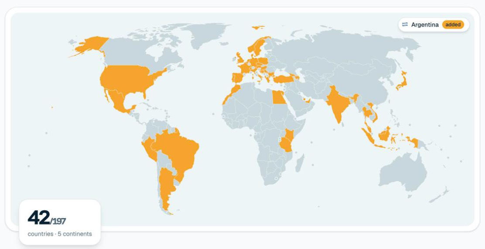
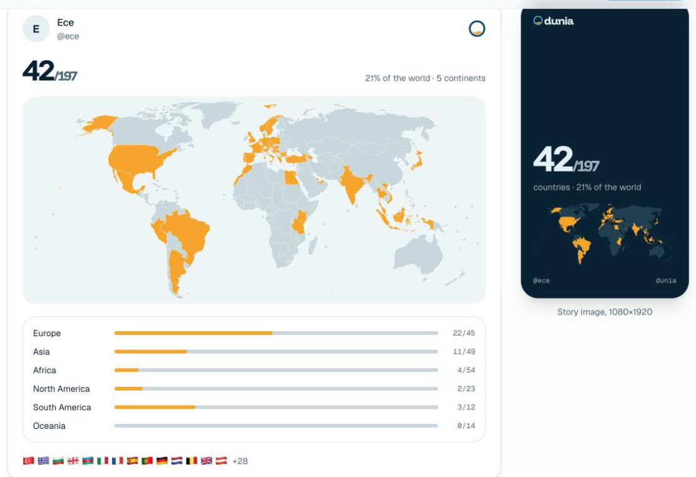
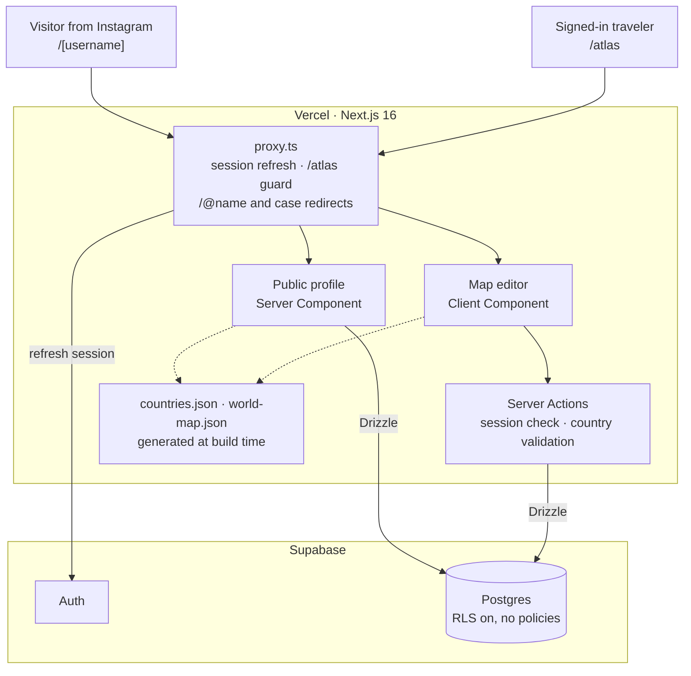
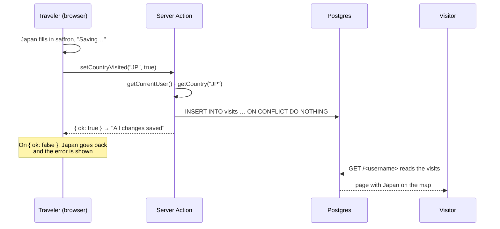
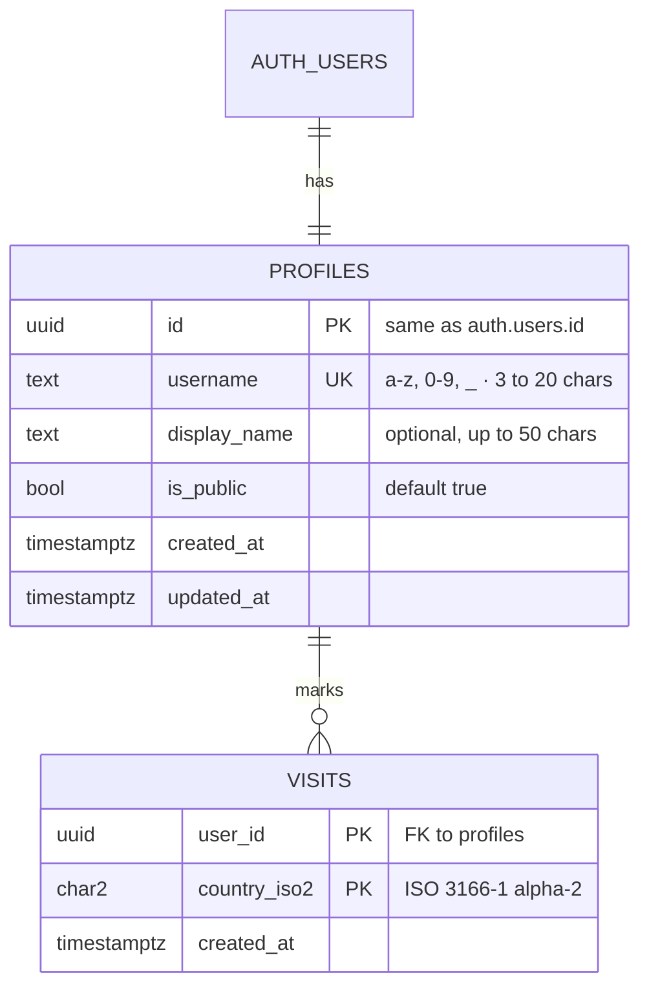

# Dunia

**A travel map for the number in your bio.** Mark the countries you've been to, watch your world fill in, and share a page that shows the map behind your "42/197".

**[Live app](https://duniamap.vercel.app)** · Built with Next.js 16, React 19, Supabase and Drizzle



| | |
|---|---|
| **What it is** | A full-stack web app: marketing site, auth with usernames, a map editor, and public profile pages |
| **Stack** | Next.js 16 (App Router, Server Actions, Cache Components, Proxy) · React 19 · TypeScript · Supabase (Auth, Postgres) · Drizzle ORM · Tailwind CSS 4 · shadcn/ui on Base UI · d3-geo (build time only) |
| **Hosting** | Vercel (app) · Supabase (database, auth) |
| **Worth a look** | [A map with no map library](#the-map-is-drawn-at-build-time-not-in-the-browser) · [Why 197](#197-countries-one-list-generated-and-checked) · [Usernames at the root](#usernames-live-at-the-root-like-linktree) · [What I'd do next](#limitations-and-next-steps) |

---

## The problem

Travelers put "61/197" or a row of flags in their Instagram bio. It's a point of pride, but the number lives nowhere: it's typed by hand, nobody can see which countries are behind it, and different people count from different lists.

Dunia gives that number a home: **tap the countries you've visited, get a count everyone agrees on, and a link that shows the whole map.**



## Try it in a minute

1. Open [duniamap.vercel.app](https://duniamap.vercel.app) and click **Create your map**.
2. Pick a username (it's checked as you type), enter your email and a password, and confirm the email.
3. Tap countries on the map, or search for them. Small ones like Malta or Singapore have their own dot.
4. Open `duniamap.vercel.app/<your-username>`. That's the page for your bio.

## Features

**Your map (`/atlas`)**
- **Tap to mark:** an SVG world map where every country is a target, plus tappable dots for 58 countries too small to hit at world scale.
- **Search in any spelling:** matches English and Turkish names and ISO codes, ignoring accents and the Turkish dotted/dotless *i*, so "izl" finds İzlanda and "usa" finds the United States.
- **Instant saves:** the country fills in on the click; the save happens in the background and rolls back with a message if it fails.
- **Your numbers:** count out of 197, share of the world, continents visited, and a bar per continent.
- **Bring your device's countries:** anything marked in the browser before signing in can be added to the account in one click.

**Your page (`/<username>`)**
- Count, an animated map, continent bars and every country grouped by continent, designed for a phone opened from an Instagram link.
- `/@ece` and `/Ece` both lead to `/ece`. Private pages are visible only to their owner.
- A "Create your map" call to action for visitors, since every view is a potential sign-up.

**Everywhere**
- Sign-up with a username, email confirmation, sign-in and password reset.
- Light, dark and match-device themes, built from one set of brand tokens.

---

## Architecture



### Lifecycle of a tap

What happens between a traveler tapping Japan and a visitor seeing it on their page:



### Data model



Deleting a user cascades to their profile and visits. The composite primary key makes marking a country twice impossible, and the format rules are `CHECK` constraints, so the database rejects bad data even if the app has a bug. The schema in `src/db/schema.ts` is the source of truth; migrations in `drizzle/` are generated from it.

---

## Engineering decisions

Each of these was a choice between reasonable options. Here's what I picked and what it costs.

### The map is drawn at build time, not in the browser

`scripts/generate-map.mts` projects Natural Earth's country shapes with d3-geo once and writes plain SVG paths to `src/data/world-map.json` (about 40 KB gzipped). The browser renders `<path>` elements and never downloads d3, TopoJSON or a map library.

The 1:110m shapes are small but drop 30 small countries entirely, and many more are too small to tap. So the script also places a dot at the centroid of any country under 24 px² at map scale, using the 1:50m data. Archipelagos get their dot on the largest island, not the sea between islands, and Tuvalu, missing even at 1:50m, is placed by hand.

*Trade-off:* no zoom or pan yet. Small European countries are easier to find with search than on the map.

### 197 countries: one list, generated and checked

There's no single answer to "how many countries are there". Dunia counts the 193 UN member states, the two UN observer states (Vatican City, Palestine), plus Kosovo and Taiwan: the 197 most travelers already use, so their number matches everyone else's.

`scripts/generate-countries.mts` builds `src/data/countries.json` from ISO codes and CLDR names (`Intl.DisplayNames`), with overrides where CLDR's wording isn't what people say ("Congo - Kinshasa" becomes "DR Congo"). It refuses to write the file unless the counts come out at exactly 193, 195 and 197. Continents follow the UN M49 geoscheme, so the placement of Türkiye, Cyprus and the Caucasus (Asia) and Russia (Europe) is a citable rule, not an opinion.

### Authorization lives in code; RLS is the backstop

All reads and writes go through Drizzle on the server. Row Level Security is **enabled on every table with no policies**, so the Supabase Data API can't read or write a row, even with the publishable key that ships to the browser.

Every Server Action checks the session and writes only the caller's rows. Country codes are validated against the list before they reach SQL, and saving takes the desired state (`setCountryVisited(code, true)`) rather than "toggle", so a retried request can't flip a country the wrong way.

*Trade-off:* the database can't enforce ownership for me. I accepted that for one place to reason about access, in type-checked TypeScript, instead of splitting rules between SQL policies and app code.

### Usernames live at the root, like Linktree

The page people paste into their bio should be as short as possible, so profiles are `dunia/<username>` rather than `/u/<username>`. Three things keep that safe:

- **App pages share one prefix.** Everything signed-in lives under `/atlas`, so new pages never collide with usernames.
- **A generous reserved list** (`src/lib/username.ts`): today's routes, words a future page might need (`about`, `blog`, `explore`, `pricing`) and names that could pass as Dunia (`admin`, `support`, `official`). A word is easy to release later and impossible to take back.
- **Claimed at sign-up**, before the email is confirmed, with the database's unique constraint as the final word. If two people race for the same name, the loser picks another after confirming (`/welcome`).

`/@ece` and `/Ece` redirect to `/ece` in the proxy, so every profile has one address.

### The profile page waits for its data

The public profile is a blocking route (`export const instant = false`): one query, then the page arrives whole, with no skeleton flashing on a phone. Link-preview bots get the title and description in the initial HTML.

*Trade-off:* with Cache Components the layout shell streams first, so a missing profile renders the not-found page with `noindex` but an HTTP 200. A real 404 would mean a database lookup in the proxy on every request; I chose not to pay that yet.

### Small choices

- **Saffron means "visited" and nothing else.** It's the brand colour of the map, so it's never used for warnings, errors or buttons.
- **Landing animations are CSS only.** The counter counts up through a registered `@property` integer and countries fill in with staggered keyframes. No JavaScript, and nothing moves for people who prefer reduced motion.
- **Redirects can't leave the site.** The post-sign-in `next` parameter must be a same-site path, which blocks `//evil.com` and `/\evil.com`.
- **No email enumeration.** Sign-up and password reset answer the same way whether or not an address has an account.

---

## Project structure

```
src/
├── app/
│   ├── page.tsx              # Landing page
│   ├── atlas/                # Map editor (signed in) and its Server Actions
│   ├── [username]/           # Public profile and its not-found page
│   ├── login/ signup/        # Auth pages, plus forgot-password, reset-password, welcome
│   └── auth/                 # Auth Server Actions, email link callback, sign-out
├── components/
│   ├── atlas/                # World map, counter, continent bars, search, story card
│   ├── landing/              # Landing page sections
│   ├── auth/                 # Auth forms and the username field
│   └── ui/                   # shadcn components
├── data/                     # countries.json, world-map.json and their helpers
├── db/                       # Drizzle schema and client
├── lib/                      # Auth, profiles, visits, username rules, Supabase clients
└── proxy.ts                  # Session refresh, /atlas guard, profile redirects
scripts/                      # Country and map generators
drizzle/                      # Generated SQL migrations
```

## Running locally

**Requirements:** Node.js 22.18+ (the data scripts run TypeScript directly), pnpm, and a free [Supabase](https://supabase.com) project.

```bash
pnpm install
cp .env.example .env.local   # fill in from Supabase: Connect, Project Settings → API Keys
pnpm db:migrate              # create the tables
pnpm dev                     # http://localhost:3000
```

| Command | Description |
|---|---|
| `pnpm dev` | Development server |
| `pnpm build` / `pnpm start` | Production build and server |
| `pnpm lint` / `pnpm typecheck` | ESLint / route types and TypeScript |
| `pnpm db:generate` | Generate a migration from schema changes |
| `pnpm db:migrate` | Apply migrations |
| `pnpm db:studio` | Drizzle Studio |
| `pnpm generate:countries` | Rebuild `src/data/countries.json` |
| `pnpm generate:map` | Rebuild `src/data/world-map.json` (after the countries) |

## Deploying

The live app runs on Vercel. Set `NEXT_PUBLIC_SUPABASE_URL`, `NEXT_PUBLIC_SUPABASE_PUBLISHABLE_KEY`, `DATABASE_URL` (the transaction pooler, port 6543) and `NEXT_PUBLIC_SITE_URL` (the deployed domain, used in confirmation and reset emails) for every environment. `NEXT_PUBLIC_` values are baked in at build time, so redeploy after changing them.

In Supabase, set **Authentication → URL Configuration** so the Site URL is the deployed domain and `/auth/callback` is an allowed redirect.

## Limitations and next steps

In rough priority order:

1. **Sharing images.** The story card on the landing page is a design, not yet a downloadable 1080×1920 image, and profile links don't have a map preview (Open Graph image) yet. Both are next.
2. **Settings.** Users can't yet change their username or display name, make their page private, or delete their account from the app.
3. **Automated tests.** There are none yet; type checking, lint and the production build are the safety net. First: Playwright for sign-up → mark a country → see it on the public page, and unit tests for the username rules, search normalization and visit stats.
4. **Email delivery.** Supabase's built-in email service is rate-limited; a custom SMTP provider is needed before launch.
5. **The map.** No zoom yet, and flags are emoji, which Windows shows as letters. SVG flags would fix that.
6. **Free-tier pausing.** Supabase pauses free projects after a week without database activity.

## Credits

Country shapes are from [Natural Earth](https://www.naturalearthdata.com) (public domain) via [world-atlas](https://github.com/topojson/world-atlas). Country names come from the Unicode [CLDR](https://cldr.unicode.org). Fonts are [Funnel Display](https://fonts.google.com/specimen/Funnel+Display) and [Geist](https://vercel.com/font), both under the SIL Open Font License.

*Dunia* means "world" in Indonesian, Malay and Swahili. It comes from the Arabic *dunyā*, "the nearest one", and travelled with merchants across the Indian Ocean into Turkish, Persian, Hindi and more. The logo is a globe filling with a saffron wave, and on a profile the wave rises with the share of the world you've seen.
